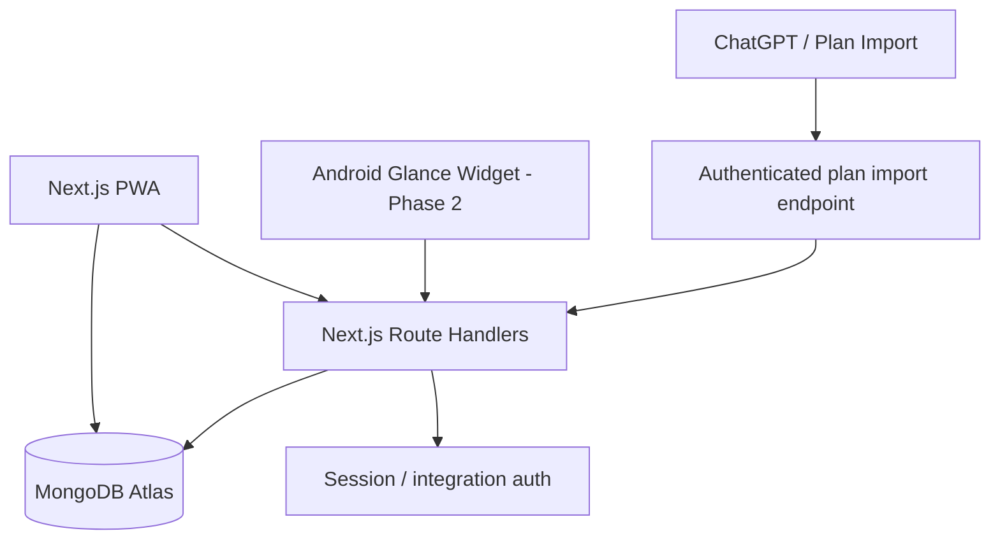

# DayFlow architecture

## Product boundaries

DayFlow is a single-owner personal planner in its first release. The web app is the primary interface; MongoDB Atlas is the durable source of truth. A native Android Glance widget is a separate client of the same authenticated API and is intentionally not conflated with a PWA home-screen shortcut.

## Runtime topology

## Collections

- `plans`: one finalized plan per `(workspaceId, externalKey)`; revisioned, timezone-aware.
- `tasks`: normalized, independently updateable tasks; indexed by workspace/date/order and by source/sourceTaskId.
- `login_attempts`: short-lived IP-hash rate-limit records; TTL index.

## Synchronization contract

`POST /api/integrations/plans/import` accepts a validated plan payload. The caller supplies a stable `externalKey` and each task can supply a stable `key`. The endpoint upserts the plan and source tasks. A payload hash makes exact retries no-ops; stable task keys prevent duplicate records. Existing task completion states are preserved; tasks removed from a later revision are cancelled unless already completed.

The endpoint requires `Authorization: Bearer <DAYFLOW_SYNC_TOKEN>`. Never expose this token to browser JavaScript, public app config, source control or user-facing logs. The initial implementation scopes all imported plans to the personal workspace; do not expose this route publicly until a production token is configured and rotated securely.

## Authentication

First release uses one administrator account configured by environment variables. Passwords are bcrypt hashes; sessions are short-lived signed HS256 JWTs in Secure/HttpOnly/SameSite=Lax cookies. The model is intentionally single-owner and must be upgraded to a multi-user identity/workspace model before team access or shared accounts.

## Runtime considerations

- Use Node.js runtime for MongoDB routes.
- Reuse one MongoClient promise across warm serverless invocations.
- Keep Vercel function region close to the Atlas cluster (Mumbai `bom1` if Atlas is in Mumbai).
- Keep `MONGODB_URI`, password hash, auth secret and sync token server-only.
- Do not fall back to in-memory storage in production. If MongoDB is missing, API requests return a visible configuration error rather than silently losing data.
- Demo mode is for preview UX only; it stores tasks in browser localStorage and is not a durable database.
